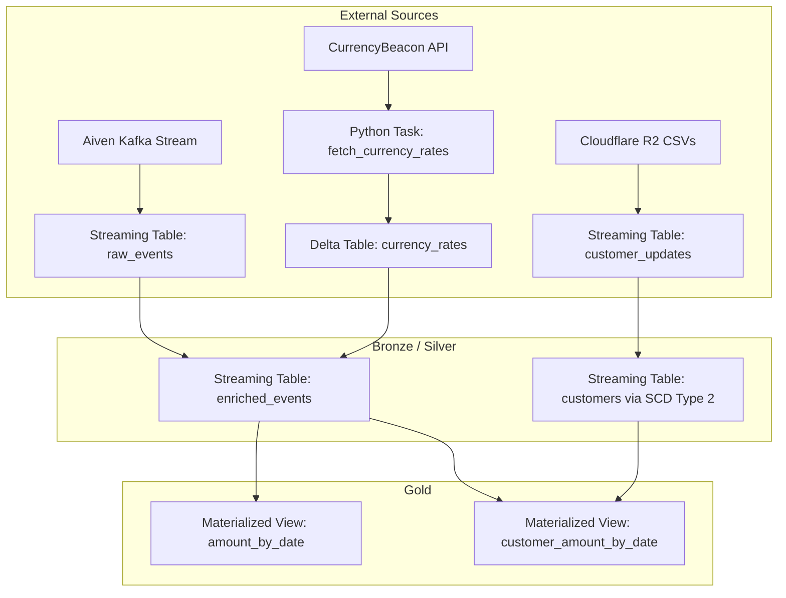
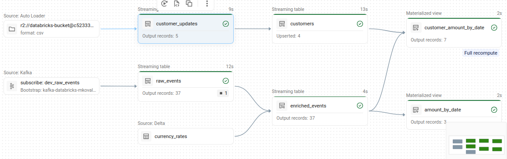

# Databricks Data Engineer Associate Preparation

## 1. Project Overview
This repository contains a hands-on Data Engineering project designed for preparation towards the **Databricks Certified Data Engineer Associate** certification. It implements an automated **Lakeflow Spark Declarative Pipelines (SDP)** *(formerly Delta Live Tables / DLT)* data pipeline for processing customer events and profile updates using **Declarative Automation Bundles (DAB)**, **Unity Catalog**, **Aiven Kafka**, **Cloudflare R2**, and **GitHub Actions CI/CD**.

## 2. Architecture & Data Flow
Data flows from real-time streaming sources and external object storage through Medallion layers (Bronze, Silver, Gold) processed via Lakeflow Spark Declarative Pipelines (SDP).

- **Bronze Layer**: 
  - `raw_events`: Streaming table ingestion via Kafka stream (`read_kafka`) from the configured Kafka topic with SSL/SASL-SCRAM authentication, applying data quality expectations (`expect_or_drop` dropping rows where `currency` is not `'USD'` or `'BYN'`).
  - `customer_updates`: Streaming table ingestion via Auto Loader (`read_files`) from Cloudflare R2 external locations containing customer CSV profiles.
  - `currency_rates`: Delta table storing daily exchange rates for `USD` and `EUR` relative to `BYN`, populated periodically via an orchestrated Python task.
- **Silver Layer**:
  - `enriched_events`: Streaming table joining `raw_events` with `currency_rates` (stream-static join) to normalize transaction amounts into `amount_byn`.
  - `customers`: Streaming table populated via **Auto CDC / SCD Type 2** (`AUTO CDC INTO` / `APPLY CHANGES INTO`) from `customer_updates` keyed on `customer_id`, handling soft deletes (`APPLY AS DELETE WHEN operation = 'DELETE'`) and sequence ordering.
- **Gold Layer**:
  - `amount_by_date`: Materialized view aggregating total transaction amounts by date (`date_total_byn`).
  - `customer_amount_by_date`: Materialized view joining `enriched_events` and `customers` (point-in-time SCD Type 2 lookup using `__start_at` and `__end_at`) to calculate daily totals per customer (`name`, `address`, `date`).

### Data Flow Diagram (Mermaid)


### Pipeline Graph (Databricks Lakeflow UI)


## 3. Repository Structure
```text
.
├── databricks.yml                       # Main Databricks Asset Bundle configuration
├── resources/
│   ├── variables.yml                    # Bundle variables definition
│   ├── infrastructure.yml               # Unity Catalog schemas, managed volumes, secret scopes & external locations
│   ├── pipelines/
│   │   └── customer_events.pipeline.yml # Lakeflow SDP pipeline definition
│   └── jobs/
│       ├── customer_events.job.yml      # Lakeflow Job orchestrating the main pipeline (every 30 mins)
│       └── fetch_currency_rates.job.yml # Lakeflow Job fetching currency rates daily at 08:00 UTC
├── src/
│   ├── pipelines/
│   │   ├── 02_customers_scd2.sql        # Silver customer SCD Type 2 CDC flow & source
│   │   ├── 03_events.py                 # Bronze raw_events (Kafka stream) & enriched_events
│   │   └── 04_aggregations.sql          # Gold materialized views & aggregations
│   └── tasks/
│       └── fetch_currency_rates.py      # Python script fetching daily rates from CurrencyBeacon API & merging into Delta
├── test_data/
│   ├── customers/                       # Test CSV files for customer profiles
│   └── events/                          # Test CSV files for customer events
├── kafka_certs/
│   └── ca.pem                           # Aiven Kafka CA certificate stored in managed volume
└── .github/
    └── workflows/
        └── deploy.yml                   # GitHub Actions CI/CD deployment & integration test pipeline
```

## 4. Tech Stack
- **Databricks Asset Bundles (DAB)**: Infrastructure as Code for defining, validating, and deploying Databricks resources across environments.
- **Lakeflow Spark Declarative Pipelines (SDP / DLT)**: Declarative SQL and Python streaming tables, Auto CDC (SCD Type 2), data quality expectations, and materialized views running serverless with Photon acceleration.
- **Lakeflow Jobs**: Workflow orchestration, scheduling (Quartz cron), and notification webhooks.
- **Unity Catalog**: Unified governance managing catalogs (`prep_dev`, `prep_prod`), schemas, managed volumes (`files`), secret scopes, and external storage locations.
- **Aiven Kafka**: Real-time event streaming source secured with SASL-SCRAM and SSL.
- **Cloudflare R2**: Object storage integration for customer profile ingestion via Auto Loader.
- **GitHub Actions**: Automated CI/CD pipelines for bundle validation, deployment, R2 test data syncing, secret provisioning, and pipeline integration tests.

## 5. Configuration & Deployment (DAB)

### Environments & Variables (`databricks.yml`)
The bundle defines two targets:
- **`dev`**:
  - Mode: `development` (automatically prefixes schemas/resources for isolated development).
  - Catalog: `prep_dev`, Base Schema: `default`.
  - Kafka Topic: `dev_raw_events`.
- **`prod`**:
  - Mode: `production`.
  - Catalog: `prep_prod`, Schema: `default`.
  - Kafka Topic: `prod_raw_events`.
  - Runs as a Service Principal with explicit ACL permissions (`CAN_MANAGE`).

### Essential DAB Commands
- **Validate bundle configuration**:
  ```bash
  databricks bundle validate
  ```
- **Deploy bundle to target (e.g., `dev`)**:
  ```bash
  databricks bundle deploy -t dev
  ```
- **Run the orchestration jobs**:
  ```bash
  databricks bundle run customer_events_job -t dev
  databricks bundle run fetch_currency_rates_job -t dev
  ```

## 6. CI/CD Pipeline
The GitHub Actions workflow (`.github/workflows/deploy.yml`) automates deployment and integration testing:

1. **Triggers**: Runs on push to `develop` or `master`, pull requests to `master`, or manual `workflow_dispatch`.
2. **`deploy-dev` Job** (on `develop` branch or PR):
   - Validates bundle configuration (`databricks bundle validate`).
   - Deploys bundle to `dev` target (`databricks bundle deploy -t dev --auto-approve`).
   - Syncs test customer CSVs to Cloudflare R2 external storage bucket.
   - Uploads Kafka CA certificates (`ca.pem`) to the Databricks managed volume.
   - Provisions required secrets (`kafka_user`, `kafka_password`, `currencybeacon_api_key`) into the Databricks secret scope.
   - Triggers integration test execution (`fetch_currency_rates_job` and `customer_events_job`).
3. **`deploy-prod` Job** (on `master` branch push):
   - Validates bundle configuration and deploys to `prod` target under GitHub `production` environment protection rules.
