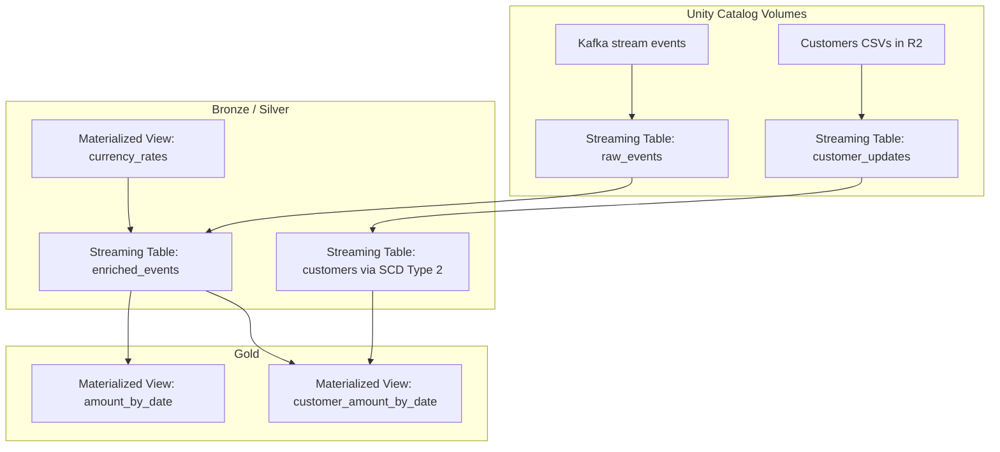

# Databricks Data Engineer Associate Preparation

## 1. Project Overview
This repository contains a hands-on Data Engineering project designed for preparation towards the **Databricks Certified Data Engineer Associate** certification. It implements an automated **Lakeflow Spark Declarative Pipelines (SDP)** *(formerly Delta Live Tables / DLT)* data pipeline for processing customer events and profile updates using **Declarative Automation Bundles (DAB)**, **Unity Catalog**, and **GitHub Actions CI/CD**.

## 2. Architecture & Data Flow
Data flows from raw CSV files stored in Unity Catalog Volumes through Medallion layers (Bronze, Silver, Gold) processed via Lakeflow Spark Declarative Pipelines (SDP).

- **Bronze Layer**: 
  - `raw_events`: Streaming table ingestion via Kafka stream (`read_kafka`) from `dev_raw_events` topic with data quality expectations (dropping rows where `currency` is not `'USD'` or `'BYN'`).
  - `customer_updates`: Streaming table ingestion via Auto Loader (`read_files`) from `r2://<bucket-name>@<cloudflare-account-id>.r2.cloudflarestorage.com/<target>/customers`.
  - `currency_rates`: Static materialized view providing exchange rates for `USD` and `BYN`.
- **Silver Layer**:
  - `enriched_events`: Streaming table joining `raw_events` with `currency_rates` (stream-static join) to normalize amounts into `amount_byn`.
  - `customers`: Streaming table populated via **Auto CDC / SCD Type 2** (`AUTO CDC INTO` / `APPLY CHANGES INTO`) from `customer_updates` keyed on `customer_id` with soft-delete handling.
- **Gold Layer**:
  - `amount_by_date`: Materialized view aggregating total amounts by date (`date_total_byn`).
  - `customer_amount_by_date`: Materialized view joining `enriched_events` and `customers` (point-in-time SCD Type 2 lookup) to calculate daily totals per customer (`name`, `address`, `date`).

### Data Flow Diagram (Mermaid)


### Pipeline Graph (Databricks Lakeflow UI)


## 3. Repository Structure
```text
.
├── databricks.yml                       # Main Declarative Automation Bundle configuration
├── resources/
│   ├── variables.yml                    # Bundle variables definition
│   ├── infrastructure.yml               # Unity Catalog schema and managed volume definition
│   ├── pipelines/
│   │   └── customer_events.pipeline.yml # Lakeflow SDP pipeline definition
│   └── jobs/
│       └── customer_events.job.yml      # Lakeflow Job orchestrating the pipeline
├── src/
│   └── pipelines/
│       ├── 01_sources.sql               # Bronze sources & enriched events
│       ├── 02_customers_scd2.sql        # Silver customer SCD Type 2 CDC flow
│       └── 03_aggregations.sql          # Gold materialized views & aggregations
├── test_data/
│   ├── customers/                       # Test CSV files for customer profiles
│   └── events/                          # Test CSV files for customer events
└── .github/
    └── workflows/
        └── deploy.yml                   # GitHub Actions CI/CD pipeline
```

## 4. Tech Stack
- **Declarative Automation Bundles (DAB)**: Infrastructure as Code and multi-environment deployment management.
- **Lakeflow Spark Declarative Pipelines (SDP / DLT)**: Declarative SQL-based streaming tables, Auto CDC (SCD Type 2), data quality expectations, and materialized views.
- **Lakeflow Jobs**: Workflow orchestration and failure notifications.
- **Unity Catalog**: Data governance managing catalogs (`prep_dev`, `prep_prod`), schemas, and managed volumes (`files`).
- **GitHub Actions**: CI/CD automation for bundle validation, deployment, test data seeding, and integration runs.

## 5. Configuration & Deployment (DAB)

### Environments & Variables (`databricks.yml`)
The bundle defines two targets:
- **`dev`**:
  - Mode: `development` (automatically prefixes schemas/resources for isolated development).
  - Catalog: `prep_dev`, Base Schema: `default`.
- **`prod`**:
  - Mode: `production`.
  - Catalog: `prep_prod`, Schema: `default`.
  - Runs as a Service Principal with explicit ACL permissions (`CAN_MANAGE`).

### Essential DAB Commands
- **Validate bundle configuration**:
  ```bash
  databricks bundle validate
  ```
- **Deploy bundle to target (e.g., `dev`)**:
  ```bash
  databricks bundle deploy -t dev
  ```
- **Run the orchestration job**:
  ```bash
  databricks bundle run customer_events_job -t dev
  ```

## 6. CI/CD Pipeline
The GitHub Actions workflow (`.github/workflows/deploy.yml`) automates deployment and integration testing across branches:

1. **Triggers**: Runs on push to `develop` or `master`, pull requests to `master`, or manual `workflow_dispatch`.
2. **`deploy-dev` Job** (on `develop` branch or PR):
   - Validates the bundle configuration (`databricks bundle validate`).
   - Deploys the bundle to the `dev` target (`databricks bundle deploy -t dev --auto-approve`).
   - Resolves the isolated development schema, creates target directories (`events` and `customers`) in the Unity Catalog Volume, and uploads test CSVs from `./test_data/`.
   - Triggers an integration test run of the job (`databricks bundle run customer_events_job -t dev`).
3. **`deploy-prod` Job** (on `master` branch push):
   - Validates bundle configuration.
   - Deploys the bundle to the `prod` target (`databricks bundle deploy -t prod --auto-approve`) under GitHub `production` environment protection rules.
